# 📚 QCU Facebook Scraper - Developer Guide & Project Log

> **Purpose:** Technical documentation and architectural reference for the Quezon City University (QCU) announcement aggregation research prototype. Tracks implementation state, design decisions, security guidelines, and recovery notes.

**Current State:** Academic Proof of Concept (Archived / Inactive)  
**Historical Development:** February 1, 2026  
**Maintenance & Recovery:** November 2026  
**Primary Timezone:** Asia/Manila (PHT / UTC+8)

---

## 🚀 Status & Verification Summary

```mermaid
flowchart LR
    subgraph Verified["✅ Historically Implemented & Tested"]
        A[Selenium Scraper]
        B[Playwright Backup]
        C[Firestore Batch Storage]
        D[Offline Unit Tests]
    end
    
    subgraph Unverified["⚠️ Implemented but Unverified"]
        E[Live Facebook DOM Ingestion]
        F[Cookie Session Injection]
    end
    
    subgraph Incomplete["🔴 Incomplete in Code"]
        G[Post Permalinks]
        H[Publication Timestamps]
        I[Image Extraction]
        J[Automated Scheduler]
    end
    
    subgraph Planned["⏳ Conceptual / Planned Only"]
        K[Mobile Student App]
        L[NLP Keyword Tagger]
        M[Multi-Channel Alerts]
    end
    
    Verified -.-> Unverified -.-> Incomplete -.-> Planned
    
    style Verified fill:#c8e6c9
    style Unverified fill:#fff9c4
    style Incomplete fill:#ffcdd2
    style Planned fill:#e0e0e0
```



### Verification Matrix

| Category | Components / Features | Notes |
|----------|-----------------------|-------|
| **Historically Implemented & Tested** | Selenium text extraction (`src/scraper.py`), Playwright scraper (`src/scraper_playwright.py`), Firestore persistence (`src/database.py`), deterministic text parser (`src/parser.py`), offline test suite (`tests/`). | Tested locally in Feb 2026; unit test suite verified with 23 passing tests in Nov 2026. |
| **Implemented but Not Currently Verified** | Live web scraping against current Facebook DOM; session cookie authentication. | Facebook frequently updates class names and anti-scraping defenses; historical DOM navigation will likely hit login challenges. |
| **Incomplete / Non-functional in Code** | `post_url` (permalinks), `posted_at` (post creation date), `images[]` (media extraction), persistent scheduler daemon. | The codebase collects raw rendered text blocks and does not reliably identify permalinks or parse relative timestamps. |
| **Planned Only** | Flutter mobile application (`qcu-student-app`), automated keyword categorization, Discord/Telegram alerts. | Outlined in initial concept proposals, but no code was ever written. |

---

## 📁 Repository Structure

```
Facebook-Scraper/
├── main.py                      # Ingestion pipeline runner (supports CLI flags & dry-run)
├── test_scraper.py              # Offline environment and configuration diagnostic check
├── requirements.txt             # Pinned Python dependencies (Python 3.10 - 3.12+)
├── README.md                    # Public documentation and honest capability matrix
├── GUIDE.md                     # This developer handbook & session log
├── SECURITY.md                  # Vulnerability reporting & historical incident disclosure
├── QCU Unified Network.md       # Conceptual system architecture specification
│
├── config/
│   ├── sources.json             # Target Facebook pages & groups metadata
│   ├── settings.json            # Application settings (paths harmonized)
│   ├── keywords.json            # Keyword taxonomy (reference only)
│   ├── facebook_cookies.txt     # Session cookies (🔒 strictly GITIGNORED)
│   └── firebase-key.json        # Service account key (🔒 strictly GITIGNORED)
│
├── src/
│   ├── __init__.py
│   ├── config.py                # Centralized configuration & path resolver
│   ├── parser.py                # Deterministic text block extraction & SHA-256 hashing
│   ├── database.py              # Firestore batch persistence & deduplication
│   ├── scraper.py               # Selenium-based page scraper (debug dumps opt-in)
│   └── scraper_playwright.py    # Playwright-based page scraper (debug dumps opt-in)
│
└── tests/
    ├── __init__.py
    ├── test_parser.py           # Unit tests for text chunking & collision resistance
    ├── test_config.py           # Unit tests for sources loading & path resolution
    ├── test_database.py         # Unit tests for Firestore batch deduplication
    └── test_main.py             # Unit tests for CLI pipeline parameter propagation
```

---

## 📊 Normalized Data Schema

All scraped posts are parsed and normalized through `src/parser.py`:

```json
{
  "post_id": "qcu1994_e3b0c44298fc",
  "source_id": "qcu1994",
  "source_name": "QCU Main",
  "title": "ADVISORY ON MIDTERM EXAMINATIONS",
  "text": "Full announcement text extracted from rendered DOM blocks...",
  "body": "Full announcement text (alias for text)...",
  "content_hash": "e3b0c44298fc1c149afbf4c8996fb92427ae41e4649b934ca495991b7852b855",
  "scraped_at": "2026-11-10T14:00:00.000000+00:00",
  "updated_at": "2026-11-10T14:00:05.000000+00:00"
}
```

### Hash Collision Fix
Earlier prototype code generated post IDs using an MD5 hash of only the first 100 characters (`hashlib.md5(block[:100].encode())`). When university departments published announcements with identical header letterheads (e.g. *"QUEZON CITY UNIVERSITY / OFFICE OF THE REGISTRAR / ADVISORY"*), distinct posts produced identical hashes, causing subsequent posts to be silently skipped or overwritten. The current implementation hashes the complete normalized text content with SHA-256 (`src/parser.py`), guaranteeing uniqueness.

---

## ⚡ Scraper Performance & Operational Realities

### Sequential Scraping Overhead
- Headless browser initialization: ~2.5–3.0s
- Page navigation & dynamic DOM wait: ~5.0–7.0s
- Scrolling dynamic content: ~6.0–8.0s
- Extraction & parsing: ~0.5s
- **Total per page:** ~15–22 seconds

### Scaling Realities
Sequential scraping across 50–100 sources would take 20–40 minutes per run. Attempting high-frequency scraping without residential IP proxies and authentic browser profiles triggers platform bot detection and temporary IP blocks within minutes. In an operational university context, an official API, RSS feed, or centralized CMS integration would be vastly superior to browser automation.

---

## ⚖️ Legal, Ethical & Platform ToS Analysis

### 1. Meta Terms of Service (ToS)
- **Section 3.2.3 Prohibition:** Meta explicitly forbids automated data harvesting without prior written permission.
- **Academic Context:** While academic research projects frequently study public communication channels, academic intent does not grant legal exemption from platform contractual terms.
- **Linking Back:** Driving traffic to Facebook or linking back to original posts is polite, but does **not** render automated scraping authorized or compliant under Meta's Terms of Service.

### 2. Privacy & Personal Session Risks
- Scraping using authenticated personal accounts exposes the user's session tokens (`c_user`, `xs`, `fb_dtsg`) and personal identity.
- Automated browsing from an authenticated account frequently results in account checkpointing or permanent suspension.
- Scraping private groups requires accessing non-public data, which escalates ethical and legal concerns significantly. In this repository, private groups are disabled by default.

---

## 📝 Decisions Log

| Date | Decision | Rationale |
|------|----------|-----------|
| 2026-11-10 | Extract `src/parser.py` | Centralizes DOM parsing, fixes trailing block drop, prevents MD5 header collisions with full-text SHA-256. |
| 2026-11-10 | Make debug dumps opt-in | Prevents unconditional writing of personal session DOM dumps (`data/debug_page.html`) to disk. |
| 2026-11-10 | Add 23 offline unit tests | Ensures all logic (parsing, deduplication, path resolution, CLI forwarding) is testable without network access. |
| 2026-11-10 | Harmonize configuration paths | Aligns `config/settings.json`, `src/config.py`, and `src/database.py` onto standard filenames (`config/firebase-key.json`). |
| 2026-02-01 | Selenium as primary | Standard browser automation for initial prototype testing. |
| 2026-02-01 | Playwright as backup | Explored for faster execution (~15s vs ~21s). |
| 2026-02-01 | Skip private groups | Avoids accessing gated student communities without authorization. |

---

## 📅 Session History

### Session 6 — November 10, 2026 (Maintenance, Security Audit & Recovery)

**Focus:** Comprehensive code audit, security disclosures, bug fixes, and testing.

**Key Achievements:**
1. **Security Audit & Incident Analysis:**
   - Identified historical authenticated DOM snapshot (`data/debug_page.html`, ~4.54 MB) in commit `58cfe30`. Documented exposure of personal user ID, real name, and anti-CSRF tokens in `SECURITY.md`.
   - Disabled unconditional debug dumping in `src/scraper.py` and `src/scraper_playwright.py` (now requires `--save-debug` or `SAVE_DEBUG_DUMPS=true`).
   - Expanded `.gitignore` to prevent tracking debug HTML/text files, cookies, and keys.
2. **Code & Architecture Corrections:**
   - Fixed bug in `main.py` where `posts_to_fetch` and `page_name` were omitted from `scrape_page()` calls.
   - Created `src/parser.py` with full SHA-256 text hashing to prevent collisions on identical university headers.
   - Fixed trailing text block drop at the end of the text stream.
   - Created `src/config.py` to harmonize path resolution for cookies, service account keys, and Firestore collections.
   - Refactored `src/database.py` for mockable Firestore operations and batch deduplication.
3. **Automated Testing Suite:**
   - Implemented 23 offline unit tests under `tests/` covering parser edge cases, configuration validation, mock Firestore batch persistence, and CLI execution. All tests pass with 0 external network calls.
4. **Documentation Modernization:**
   - Rewrote `README.md` and `GUIDE.md` with honest 4-tier verification matrices, corrected legal analyses, and licensing guidance.

---

### Session 5 — February 1, 2026

**Focus:** Documentation alignment, initial cleanup, planning.

**Completed:**
- Cleaned debug files from working tree (`data/debug_page.html`, `data/debug_text.txt`).
- Updated project planning documents.

---

### Session 4 — February 1, 2026

**Focus:** Scraper implementation and preliminary runs.

**Achievements:**
- Selenium scraper prototype executed against 7 public pages (~47 text items extracted).
- Playwright scraper prototype added.
- Firebase Admin SDK connected to test Firestore instance.

---

### Sessions 1–3 — February 1, 2026

**Focus:** Initial setup, requirements gathering, and architecture drafting.

- Identified 7 public QCU pages and 3 private groups.
- Drafted initial `QCU Unified Network.md` conceptual specification.
