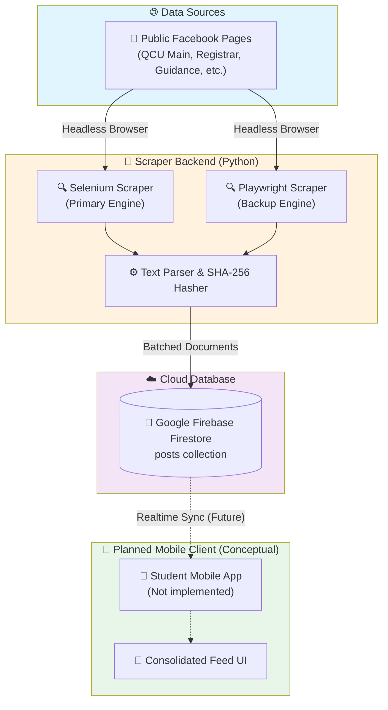
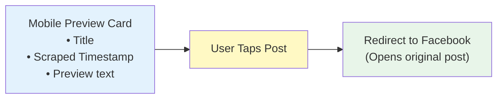
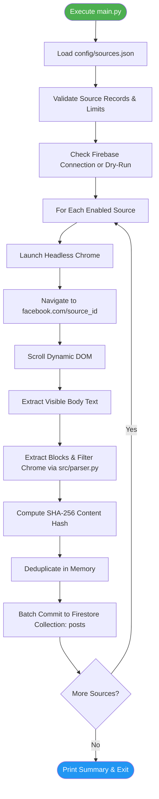

# 🏛️ QCU Unified Network - Conceptual System Architecture

> **Document Type:** Conceptual System Architecture & Technical Specification  
> **Original Date:** February 1, 2026  
> **Recovery & Audit Date:** November 2026  
> **Current Status:** Proof-of-concept backend prototype archived; mobile client planned only  

**Objective:** Explore centralizing fragmented university announcements across Quezon City University (QCU) campuses into a single, accessible mobile feed for students.

---

## 📋 Table of Contents

1. [System Overview & Concept](#1-system-overview--concept)
2. [Implementation & Verification Status](#2-implementation--verification-status)
3. [Multi-Repository Strategy](#3-multi-repository-strategy)
4. [Backend Scraper Pipeline](#4-backend-scraper-pipeline)
5. [Database Architecture (Firebase)](#5-database-architecture-firebase)
6. [Mobile App Specification (Conceptual)](#6-mobile-app-specification-conceptual)
7. [Normalized Data Schema](#7-data-schema)
8. [Risk Assessment & Limitations](#8-risk-assessment--limitations)
9. [Related Documents](#9-related-documents)

---

## 1. System Overview & Concept

### Conceptual System Architecture



### Display Strategy: Preview Card → Redirect
Rather than caching entire Facebook pages or scraping media assets that may violate copyright or quickly break due to CDN link expiration, the architecture adopts a lightweight **Preview Card → Redirect** paradigm:



---

## 2. Implementation & Verification Status

| Category | Component | Status | Notes |
|----------|-----------|--------|-------|
| **Historically Implemented** | Python DOM scraper | ✅ Verified | Selenium and Playwright scripts extract text blocks from rendered DOM. |
| **Historically Implemented** | Firebase Firestore persistence | ✅ Verified | Batch writing to `posts` collection with deduplication. |
| **Tested (Nov 2026)** | Automated test suite | ✅ Verified | 23 offline unit tests in `tests/` covering parsing, configuration, and mock database operations. |
| **Unverified (Live)** | Live Facebook scraping | ⚠️ Unverified | Facebook DOM obfuscations and bot detection change frequently; historical selectors may require updates. |
| **Incomplete** | Post permalinks (`post_url`) | 🔴 Incomplete | Not extracted by text parser. |
| **Incomplete** | Post creation timestamps (`posted_at`) | 🔴 Incomplete | Only scraping execution time (`scraped_at`) is recorded. |
| **Incomplete** | Image extraction & storage | 🔴 Incomplete | No media downloader or Firebase Storage uploader exists in code. |
| **Incomplete** | Background scheduler daemon | 🔴 Incomplete | Execution is manual CLI invocation only. |
| **Planned Only** | Student mobile application | ⏳ Concept Only | No Flutter code or mobile repository was developed. |
| **Planned Only** | Multi-channel notifications | ⏳ Concept Only | Webhook alerts (Discord, Telegram, Email) are not implemented. |

---

## 3. Multi-Repository Strategy

The conceptual roadmap envisioned separating responsibilities across dedicated repositories:

| Repository | Tech Stack | Responsibility | Status |
|------------|------------|----------------|--------|
| `Facebook-Scraper` | Python 3.10–3.12 | Public announcement extraction & Firestore storage | ⚠️ Proof-of-concept prototype |
| `qcu-student-app` | Flutter / Dart | Mobile client for students (cross-platform iOS/Android) | ⏳ Planned only (never created) |
| `qcu-admin-portal` | React / Node.js | University staff portal for manual announcement publishing | ⏳ Planned only (never created) |

---

## 4. Backend Scraper Pipeline

### Technology Stack
- **Language:** Python 3.10 – 3.12+
- **Primary Scraper:** Selenium (`selenium>=4.20.0`, `webdriver-manager>=4.0.0`)
- **Backup Scraper:** Playwright (`playwright>=1.40.0`)
- **Database Client:** Firebase Admin SDK (`firebase-admin>=6.2.0`)
- **Testing:** Python standard `unittest` and `pytest>=7.4.0`

### Execution Workflow



---

## 5. Database Architecture (Firebase)

The prototype utilizes Google Cloud Firestore (NoSQL Document Store):
- **Collection:** `posts` (configurable via `FIRESTORE_COLLECTION`)
- **Document ID:** Deterministic `{source_id}_{content_hash[:12]}`
- **Security Rule Note:** Production Firestore rules must require authenticated administrative access for writes and allow read-only access for students. Service account keys must never be distributed inside client mobile applications.

---

## 6. Mobile App Specification (Conceptual)

The planned student app was designed to provide:
1. **Consolidated Feed:** Chronological cards displaying university announcements from all campus pages in one view.
2. **Category Filters:** Filter by academic unit (Registrar, Guidance, College of Computer Studies, etc.).
3. **Deep Linking:** Tap card to launch Facebook directly to read full comments or engage with the post.
4. **Offline Caching:** Local SQLite / Hive cache for viewing previously loaded advisories without data connection.

---

## 7. Normalized Data Schema

```json
{
  "post_id": "qcu1994_e3b0c44298fc",
  "source_id": "qcu1994",
  "source_name": "QCU Main",
  "title": "ADVISORY ON MIDTERM EXAMINATIONS",
  "text": "Full announcement text extracted from rendered DOM blocks...",
  "body": "Full announcement text (alias for text)...",
  "content_hash": "e3b0c44298fc1c149afbf4c8996fb92427ae41e4649b934ca495991b7852b855",
  "scraped_at": "2026-11-10T14:00:00.000000+00:00",
  "updated_at": "2026-11-10T14:00:05.000000+00:00"
}
```

---

## 8. Risk Assessment & Limitations

### Platform & Legal Considerations
- **Meta Terms of Service:** Automated scraping without explicit prior permission from Meta violates Section 3.2.3 of the Meta Terms of Service.
- **Account Vulnerability:** Injecting personal login cookies into scraping bots creates substantial risk of account compromise and suspension.
- **DOM Fragility:** Scraping front-end markup is intrinsically fragile. Minor design updates or A/B testing on Facebook can break text block parsing.
- **Sustainable University Recommendation:** For a long-term production service, university IT departments should establish direct RSS feeds, webhooks from official university portals, or formal Meta Graph API integrations rather than headless browser scraping.

---

## 9. Related Documents

- [README.md](README.md) — Public repository documentation and setup guide
- [GUIDE.md](GUIDE.md) — Developer log and technical implementation details
- [SECURITY.md](SECURITY.md) — Security policy and historical incident disclosures
